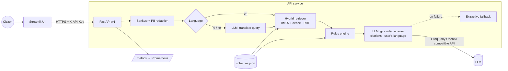

# 🤝 Yojana Saathi

**A multilingual GenAI assistant that helps Indian citizens discover the government welfare schemes they're eligible for.**

Millions of eligible people miss out on welfare benefits because scheme information is scattered, written in bureaucratic English, and eligibility rules are hard to follow. Yojana Saathi lets a citizen enter a few details, see which schemes they likely qualify for (and *why*), and ask follow-up questions in **English, Hindi or Kannada** — with every answer cited to an official source.

---

## Features

| | |
|---|---|
| **Explainable eligibility** | A deterministic rules engine — not the LLM — decides eligibility, explains the reasons, and lists what information is missing. |
| **Grounded RAG answers** | Hybrid retrieval (BM25 + `bge-small` embeddings, Reciprocal Rank Fusion). The LLM answers only from retrieved text, with `[S1]` citations. |
| **Multilingual** | Detects Hindi/Kannada, translates the query for retrieval, answers in the user's language. |
| **Safety** | PII redaction (Aadhaar, PAN, phone, email) before any LLM call or log line · prompt-injection hardening · input validation. |
| **Resilient** | Timeouts, retries with exponential backoff, and automatic fallback to extractive answers if the LLM provider fails. |
| **Production API** | FastAPI with versioned `/v1` routes, OpenAPI docs, SSE streaming, API-key auth, rate limiting, request IDs, security headers. |
| **Observable** | Structured JSON logs with correlation IDs, Prometheus metrics, example alert rules, optional Grafana. |
| **Quality gates** | 54 tests (93% coverage), ruff, mypy, retrieval eval gate (Hit@3 ≥ 0.95), dependency audit, CodeQL. |
| **Shippable** | Pinned lockfiles, hardened multi-stage Docker images (non-root, healthchecks, model baked in), docker-compose, GHCR publishing, one-click Render blueprint. |

## Architecture

"# Yojana-Sathi-AI-project-" 
