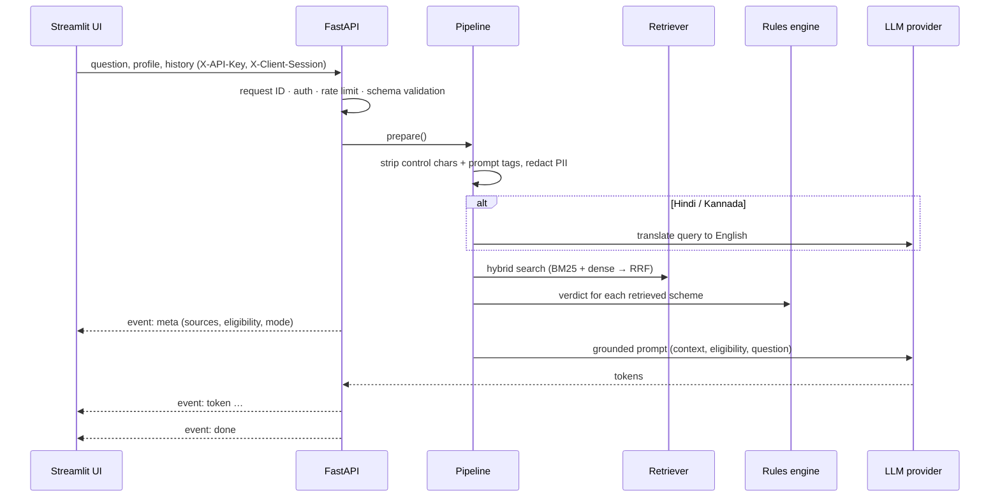

# Architecture & Design Decisions

## Request flow (`POST /v1/ask/stream`)

## Decisions

### 1. The LLM never decides eligibility
Eligibility is a legal and financial question. A probabilistic model can hallucinate an entitlement, and that harms the person who relies on it. Rules in `schemes.json` are evaluated by `eligibility.py`, a few dozen lines that are fully unit-tested and auditable. The LLM only *explains* the verdict it is given. **Trade-off:** each new scheme needs structured rules; `scripts/validate_schemes.py` and CI keep them consistent.

### 2. Hybrid retrieval with Reciprocal Rank Fusion
Citizens use both exact terms ("PM-KISAN", "436 premium") and loose descriptions ("money for farmers"). BM25 handles the first, embeddings the second. RRF fuses the two rankings without tuning score weights. **Trade-off:** with 100 chunks a brute-force dot product is instant; at scale, swap in a vector DB behind the same interface.

### 3. Small ONNX embedding model, baked into the image
`bge-small-en-v1.5` through `fastembed` needs no PyTorch or GPU and fits free 512 MB instances. The model and the vector index are built at image build time and cached on disk, keyed by model and corpus hash. Containers start without network access and without re-embedding.

### 4. Translate-then-retrieve for Indian languages
The knowledge base is in English. Rather than a larger multilingual embedding model, Hindi/Kannada queries are translated by the LLM (one cheap call), and the answer is generated in the user's language. If translation fails, the original text is used.

### 5. Graceful degradation over hard failure
| Failure | Behaviour |
|---|---|
| Embedding model unavailable | BM25-only retrieval |
| No LLM key | Extractive, cited answers |
| LLM error before first token | Extractive answer |
| LLM error mid-stream | `error` event; partial answer kept |
| API unreachable from UI | Friendly message; the rest of the page still renders |

### 6. Separate API and UI, one contract
The API is the product; the Streamlit UI is one client. This lets the two scale independently, allows other clients (WhatsApp bot, mobile app, partner NGO portals), and keeps secrets out of the browser tier. `saathi/client.py` provides an HTTP client and an in-process client with an identical contract (enforced by a parametrised test), so single-container demo hosting still works.

### 7. Security by default
* **PII:** Aadhaar/PAN/phone/email are redacted before the LLM call, logs and feedback storage.
* **Prompt injection:** user text is stripped of the prompt's own delimiter tags, wrapped in `<question>`, and the system prompt marks it untrusted. Client-supplied `system` turns in history are dropped.
* **Auth:** API keys compared in constant time; health and metrics probes stay open.
* **Abuse:** sliding-window rate limit per IP, or per end-user session for the trusted UI, with `Retry-After`.
* **Containers:** non-root user, minimal slim base, no build tools at runtime, `no-new-privileges`, dropped capabilities.
* **Supply chain:** pinned lockfiles, `pip-audit`, CodeQL, Dependabot.

### 8. Observability as a feature
Every request gets an ID (accepted from `X-Request-ID` or generated), returned in headers and error bodies, and attached to every JSON log line. Prometheus metrics cover HTTP, LLM, retrieval, answer modes and feedback; `monitoring/alerts.yml` encodes the SLOs.

## Known limitations / roadmap
* Scheme data is curated by hand; next step is a scraper with human review against myscheme.gov.in.
* Rate limiting is per process; use Redis for multi-replica deployments.
* No persistent conversation store (by design for privacy); history is held client-side.
* Voice input (Whisper) and a WhatsApp channel would reach users with limited literacy or no smartphone.
